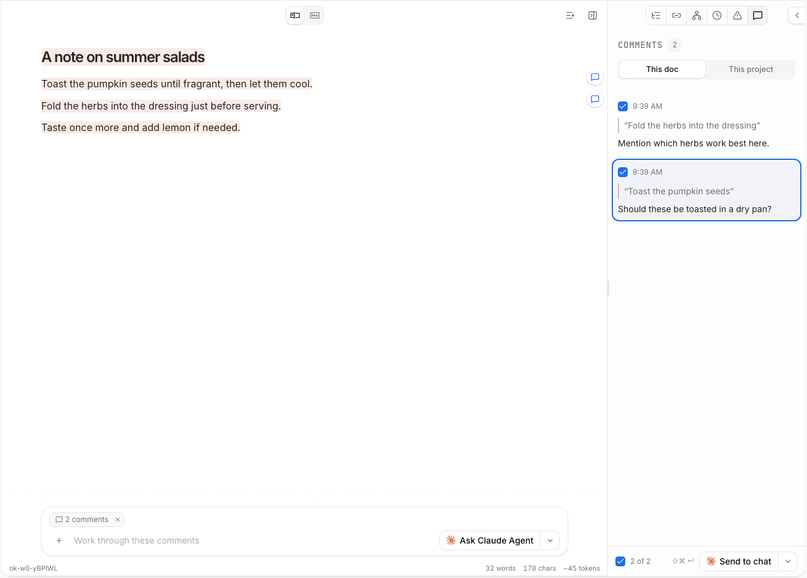

<div align="center">


# GitQuire

**A collaborative, WYSIWYG Markdown wiki for small teams, with GitHub as the backend.**

[](https://github.com/docdru/GitQuire/actions/workflows/checks.yml)
[](https://github.com/docdru/GitQuire/actions/workflows/docker.yml)
[](https://github.com/docdru/GitQuire/actions/workflows/pages.yml)
[](./LICENSE)
[](https://github.com/docdru/GitQuire/pkgs/container/gitquire)

[Documentation](https://docdru.github.io/GitQuire/docs/gitquire/overview) ·
[Deploy](./DEPLOY.md) ·
[Roadmap](#roadmap) ·
[Contributing](./CONTRIBUTING.md)

</div>

<p align="center">
  
</p>

Write together in a Notion-like editor while every page, link and comment stays a plain Markdown
file in your GitHub repository. No database to back up, no lock-in: if GitQuire disappears
tomorrow, your wiki is still a folder of `.md` files with full history.

> **Status:** early, but usable. All phases of the [roadmap](#roadmap) are in; what comes next
> depends on feedback.

## Features

### ✍️ Write together

A WYSIWYG editor with live cursors, so a meeting can take notes in one page at the same time.
Between meetings, edits are committed to `main` automatically after a short pause, under each
person's own GitHub name.

### 🌿 Plain Markdown in Git

Every page is a `.md` file in a GitHub repository. Pull it, grep it, edit it in your own editor
or let a script generate it; GitQuire picks up the changes. File names are kept link-friendly:
*Meeting Notes 2026* is saved as `meeting-notes-2026.md`.

### 🔀 Branches and pull requests

Work on `main` by default. For something bigger, like a quarterly report, create a branch from
the editor, write on it, and open a pull request without leaving GitQuire.

### 🔗 Links that stay correct

`[[Meeting Notes 2026]]` wiki links, a backlinks panel, and links rewritten automatically when a
page is renamed or moved. A broken-links list shows every link to a page that doesn't exist and
where it comes from.

### 💬 Discussions inside the file

Select text and choose **Discuss** to start a thread. Reply, `@mention` teammates and resolve when
done. Threads are saved in a hidden block at the end of the Markdown file that GitHub doesn't
render, one JSON line per thread, so they travel through branches and pull requests and diff
cleanly:

```markdown
<!-- gitquire-comments v1
{"id":"…","anchor":{"exact":"quarterly numbers","prefix":"…","suffix":"…"},"resolved":false,"comments":[…]}
-->
```

### 🔔 Mentions that reach people

An **@** inbox in the header lists every discussion where someone mentioned you. Mentions can also
go out by email (after the address is confirmed) or be posted to Slack, Teams, Discord, Mattermost
or Rocket.Chat.

### 🗂️ Pages as objects

Give a page frontmatter and it becomes an object you can list. No schema: a page has whatever
properties you give it.

```markdown
---
type: task
status: Doing
owner: alice
due: 2026-12-01
---

# Rework the landing page

- [ ] Draft the copy @bob
- [x] Collect screenshots
```

The **Views** button shows them as a filterable **table**, a drag-and-drop **board** grouped by
any property (moving a card commits the change in your name), and an **action items** list of
every checkbox across the wiki, grouped by page, due date or person. Ticking an item there writes
`[x]` into the page, committed in your name, with undo. A due date goes in the item:
`- [ ] Send the notes @bob due: 2026-12-01`.

A **timeline** lists pages with a date property, such as meeting notes, newest first by month, with
attendees, decisions (a list under a "Decisions" heading, or lines starting with `Decision:`) and
open action items. **New meeting note** creates `meeting-notes/<today>.md`.

**Save as page** stores the open view as a page in `views/` with a `gitquire-view` block, which
shows the view live; the block works in any page:

````markdown
```gitquire-view
view: board
filter: type = task
group: status
```
````

### 📱 Phones and tablets

A formatting toolbar above the on-screen keyboard, and installable as a home-screen app.

### 🤖 Bring your own AI agent

Each person connects their own Claude (or other MCP-capable) agent with a personal token, or
adds GitQuire as a connector in Claude on the web and on phones. Agent edits show up live and are
committed with that person as the author. Nothing runs on the server on anyone's behalf.

### 🔒 Self-hosted and signed in with GitHub

One Docker container with a `/data` volume. Everyone signs in with GitHub; whoever can write to
the content repository can use the wiki, and loses access when they lose repository access.

## Quick start

```bash
docker run --rm -p 8080:8080 \
  -e OK_ALLOW_EXTERNAL=1 \
  -v gitquire-data:/data \
  ghcr.io/docdru/gitquire:latest
# then open http://localhost:8080
```

This runs GitQuire locally without sign-in or sync, which is fine for a look around but not for a
shared server. **[DEPLOY.md](./DEPLOY.md)** covers setting up the GitHub App, sign-in, repository
sync, email and chat notifications, and AI agent access.

## Roadmap

Done:

1. **Shared server in Docker** with CI and a published image.
2. **GitHub sign-in**, live editing on `main`, per-user commit authorship.
3. **Branches and pull requests** from the editor.
4. **Comments stored in the Markdown files**: threads, editing, simultaneous comments, a mention
   inbox, email and chat notifications.
5. **Mobile**: toolbar above the keyboard, installable as a home-screen app. The touch link
   picker is in review (#26).
6. **Linking**: naming rules, rename rewrite, backlinks and a broken-link list.
7. **Pages as objects**: table, board and action items from frontmatter and task lists.
8. **More views**: a timeline of dated pages, ticking off action items with due dates, and saved
   views as pages.

Next, depending on feedback:

- **Pull request review**: GitHub review comments shown as page threads, or reviewing fully inside
  GitQuire.

Ideas and bug reports are welcome in [Issues](https://github.com/docdru/GitQuire/issues).

## Development

```bash
pnpm install
pnpm run check
pnpm --filter @inkeep/open-knowledge-app run dev
```

See [CONTRIBUTING.md](./CONTRIBUTING.md) and [AGENTS.md](./AGENTS.md) for the repository layout and
conventions.

## Credits and license

GitQuire is a fork of [OpenKnowledge](https://github.com/inkeep/open-knowledge) by Inkeep, Inc., and
keeps its history. The original README is in [UPSTREAM-README.md](./UPSTREAM-README.md). Parts of the
GitHub, branch, PR and comment features are adapted from
[GitMarkdown](https://github.com/pooriaarab/gitmarkdown) by Pooria Arab (MIT).

GitQuire is licensed under the [GNU General Public License v3.0 or later](./LICENSE), like
OpenKnowledge. GitQuire is not affiliated with or endorsed by Inkeep.
